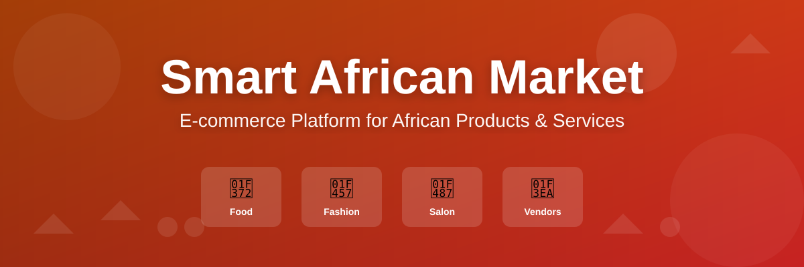

# Smart African Market

<p align="center">
  
</p>

> A self-hostable, multi-vendor marketplace for African food, fashion and salon
> services — with built-in delivery, bookings, auctions and subscriptions.

[](https://laravel.com)
[](https://php.net)
[](https://mysql.com)
[](LICENSE)

**📖 [Documentation Hub](docs/README.md)** — every document in this repository,
in one place.

---

## What this is

An e-commerce platform for the African diaspora market, built to be **installed
like a CMS**: upload it to ordinary Apache/PHP/MySQL hosting, open `/install`,
and answer a wizard. That constraint shapes the whole architecture — see
[ADR 0001](docs/architecture/decisions/0001-laravel-monolith.md).

It is considerably more than a storefront. Thirteen domains are implemented
across ~98 models, ~146 controllers and ~148 migrations.

| Domain | What it does |
|---|---|
| **Catalogue & commerce** | Products, variants, categories, brands, cart, checkout, coupons, orders |
| **Multi-vendor** | Vendor stores, custom domains, balances, ledger, payouts, withdrawals, KYC |
| **Delivery** | Zones, distance pricing, drivers, assignment, GPS tracking, proof of delivery |
| **Salon & bookings** | Services, stylists, resources, slots, tiered pricing, reminders |
| **Auctions** | Listings, live bidding, proxy auto-bids, automated settlement |
| **Subscriptions** | Customer and vendor plans, trials, renewals, module entitlements |
| **Content & CMS** | Blog with revisions, static pages, hero sections, widgets, media library, SEO |
| **AI chatbot** | Retrieval-augmented assistant over a managed knowledge base |
| **Marketing** | Campaigns, attribution, newsletters, referrals, loyalty points |
| **Support & returns** | Tickets, enquiries, refund requests, RMA |
| **Trust & safety** | Reviews with images and helpful votes, activity audit log |
| **Compliance** | GDPR data-export requests, configuration audit trail |
| **Mobile** | Native Android app consuming the REST API |

### Payments

Three rails, reflecting a Sweden + West Africa footprint:

| Provider | Covers |
|---|---|
| **Stripe** | Cards, Apple Pay, Google Pay (via Laravel Cashier) |
| **Paystack** | African cards, bank transfer, mobile money — M-Pesa, MTN, Airtel |
| **Swish** | Swedish instant payments |

Plus cash on delivery. All webhook handlers verify signatures and are idempotent.

---

## Tech stack

| Layer | Technology |
|---|---|
| Framework | Laravel 12 (PHP 8.2+) |
| Database | MySQL 8.0+ |
| Views | **Blade** + Tailwind CSS 3 + Alpine.js |
| Reactivity | Livewire 3 — used by exception, not by default ([why](docs/architecture/decisions/0002-blade-over-livewire.md)) |
| Assets | Vite |
| Auth | Laravel Sanctum, Socialite for OAuth |
| Realtime | Soketi (self-hosted) + Laravel Echo |
| Permissions | spatie/laravel-permission |
| Queue & cache | Database drivers by default — no Redis required ([why](docs/architecture/decisions/0004-database-queue-driver.md)) |

Details: [TECH_STACK.md](docs/architecture/tech-stack.md) · [Architecture Overview](docs/architecture/overview.md)

---

## Quick start

```bash
git clone https://github.com/cromstel/smart-african-marketplace.git
cd smart-african-marketplace

composer install && npm install
cp .env.example .env
php artisan key:generate

# create the databases, then set DB_* in .env
php artisan migrate --seed
php artisan storage:link

npm run dev          # terminal 1
php artisan serve    # terminal 2  →  http://localhost:8000
```

Full walkthrough, prerequisites and troubleshooting:
**[Getting Started](docs/guides/getting-started.md)**.

### Production install

Upload the files, open `http://yourdomain.com/install`, and follow the wizard
(requirements check → database → admin account → site settings). Then work
through the [Deployment Runbook](docs/operations/deployment-runbook.md).

---

## Requirements

**Server:** PHP 8.2+, MySQL 8.0+ (or MariaDB 10.6+), Apache 2.4+ with
`mod_rewrite`, 512 MB RAM minimum (2 GB recommended), 1 GB disk.

**PHP extensions:** `bcmath`, `pdo_mysql`, `mbstring`, `xml`, `curl`, `zip`,
`gd`, `fileinfo`, `openssl`, `tokenizer`, `json`.

> `bcmath` is not optional: Laravel Cashier depends on `moneyphp/money`, which
> requires it. Without it `composer install` fails outright. It was missing from
> every documented list until 2026-09-08.

**Build tools:** Composer 2.x, Node.js 18+.

> CI currently runs PHP 8.3 while `composer.json` requires `^8.2`. Reconciling
> this is [Roadmap 0.4](docs/product/roadmap.md#04-reconcile-the-php-version-low).

---

## Documentation

Everything is indexed at **[docs/README.md](docs/README.md)**. The most-used
pages:

| | |
|---|---|
| [Getting Started](docs/guides/getting-started.md) | Clone to running app |
| [Architecture Overview](docs/architecture/overview.md) | How the system fits together |
| [Data Model](docs/architecture/data-model.md) | The 98 models by domain |
| [Configuration Reference](docs/reference/configuration.md) | Every environment variable |
| [API Reference](docs/reference/api.md) | REST endpoints, auth, rate limits |
| [Artisan Commands](docs/reference/commands.md) | The 23 custom commands |
| [Testing Guide](docs/guides/testing.md) | Running and writing tests |
| [Contributing](CONTRIBUTING.md) | How to land a change |
| [Roadmap](docs/product/roadmap.md) | What we are building next, and why |
| [Documentation Audit](docs/product/documentation-audit.md) | Docs-vs-code findings |
| [Decision Records](docs/architecture/decisions/README.md) | Why things are the way they are |
| [User Documentation](docs/user-guide/README.md) | For customers, vendors and admins |

---

## Project status

Phases 1 and 2 of the original [Implementation Plan](docs/product/implementation-plan.md) are
substantially delivered: authentication, catalogue, cart and checkout, payments,
orders, the admin panel, the installer, multi-vendor, bookings, reviews,
delivery, and a native Android app are all in the codebase.

**Current focus is verification, not new features.** A
[documentation audit](docs/product/documentation-audit.md) found a feature-rich but
under-tested platform — 6 test files against 146 controllers — and several
documents that cited verification which had never been written. The
[Roadmap](docs/product/roadmap.md) sequences the work: close the integrity gaps, make the
payment path provable, build a real test foundation, then extend.

Recently closed:

- [x] Registration endpoint throttled; SEO config no longer breaks under `config:cache`
- [x] Webhook fixtures, signature and replay-idempotency tests — **passing**
- [x] Six defects that stopped a clean clone from installing, migrating or
      running at all (see [Finding 10](docs/product/documentation-audit.md#finding-10--the-application-could-not-be-installed-or-migrated-from-a-clean-clone))

`php artisan migrate` now runs all 150 migrations clean and `php artisan test`
reports **56 passed, 190 assertions**.

Next up:

- [ ] Vendor-isolation tests across all 32 vendor controllers
- [ ] Mobile-money webhook coverage
- [ ] Decide on the four available major dependency upgrades

---

## Common commands

```bash
php artisan serve                       # dev server
php artisan migrate                     # run migrations
php artisan test                        # run the suite
php artisan route:list                  # inspect routes
php artisan optimize:clear              # clear all caches
php artisan app:verify-readiness        # pre-flight check
vendor/bin/pint                         # format PHP

npm run dev / npm run build             # assets
npm run lint / npm run format           # JS and CSS
npm run test                            # Playwright
```

Full list: [Artisan Commands](docs/reference/commands.md).

---

## Before you deploy

> **Set `MOMO_WEBHOOK_SECRET` if you accept mobile money (MTN, M-Pesa).**
> The callback endpoint authenticates with an HMAC and **fails closed** — with
> no secret configured it refuses every callback with a 503, so mobile money
> payments will not be confirmed. `php artisan app:verify-readiness` flags this,
> and `--strict` blocks the deploy. See
> [Configuration](docs/reference/configuration.md#mobile-money-callbacks).

Run the readiness gate before every release:

```bash
php artisan app:verify-readiness --strict
```

---

## Security

Report vulnerabilities privately per [SECURITY.md](SECURITY.md). **Please do not
open a public issue for a security problem.**

The platform hashes passwords with bcrypt, protects forms with CSRF tokens, uses
Eloquent's parameter binding throughout, escapes output in Blade, authenticates
the API with Sanctum, rate-limits public endpoints, and verifies every payment
webhook signature with timing-safe comparison.

> **Read the [Documentation Audit](docs/product/documentation-audit.md) before relying on
> any security claim in this repository.** It identifies one logged control that
> was never implemented, and several verification tests that do not exist. The
> controls listed above were confirmed present in code; the audit says exactly
> what was and was not verified.

---

## Contributing

See [CONTRIBUTING.md](CONTRIBUTING.md) for workflow, commit conventions, code
standards and the review checklist.

Two documentation rules matter especially here: **never cite a file that does not
exist**, and **link every new document from the hub**.

---

## License

MIT — see [LICENSE](LICENSE).

---

**Made with care for the African diaspora community.**
*Connecting cultures through authentic products and services.*
