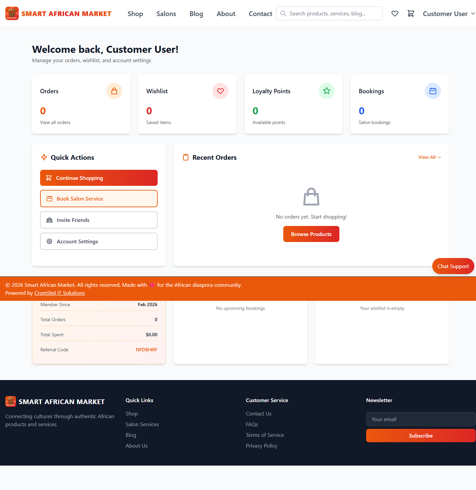

# Customer Onboarding Checklist (v2)

## Objective

Get a new customer from first visit to first successful purchase/booking.

## UI Walkthrough

1. Browse discovery pages:
   - `/`
   - `/shop`
   - `/salons`
   - `/blog`
2. Review plan and account options at `/pricing`
3. Register at `/register` or log in at `/login`
4. Land on `/dashboard`
5. Continue shopping or service booking flows

Screenshots:

## Day-0 Checklist

- [ ] Account created and email verified
- [ ] Profile details updated
- [ ] Shipping/contact details completed
- [ ] First product added to cart
- [ ] First checkout completed
- [ ] First salon booking (if applicable) completed

## Support Checklist

- [ ] Customer can access `/dashboard` after login
- [ ] Customer can return to `/shop` without auth errors
- [ ] Customer sees order history section
- [ ] Customer can log out and log in again
