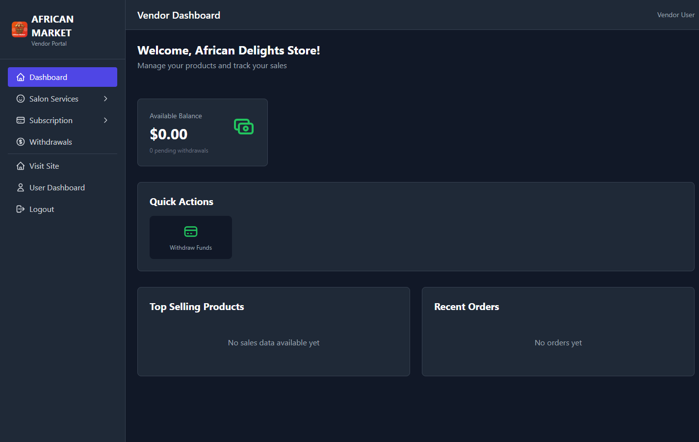
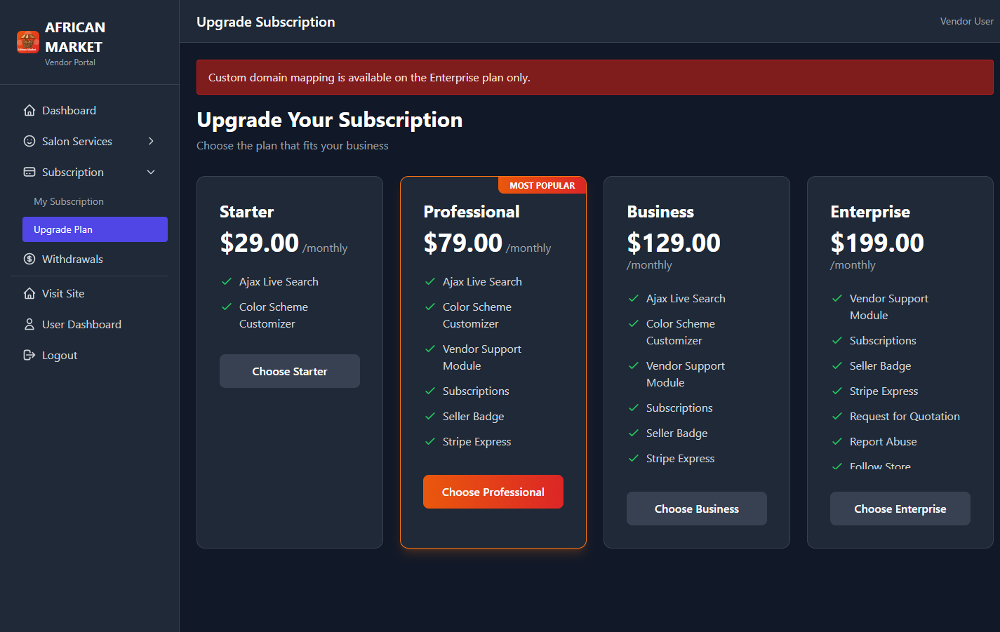
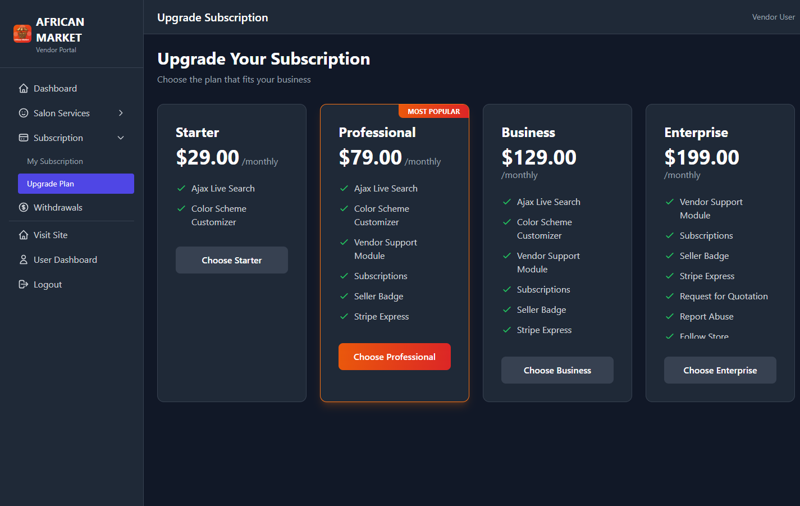

# Vendor Onboarding Checklist (v2)

## Objective

Get a vendor store from account setup to active operations with correct domain access.

## UI Walkthrough

1. Login at `/login` with vendor account
2. Confirm landing on `/vendor/dashboard`
3. Open store domain settings at `/vendor/store-domain`
4. If redirected to `/vendor/subscription/upgrade`, complete upgrade first
5. Return to `/vendor/store-domain` to configure domain details

Screenshots:

## URL Behavior Rules

- Every vendor has a platform URL:
  - `/vendors/{vendor-slug}`
  - `{vendor-slug}.{base-domain}` when base-domain routing is configured
- Only Enterprise vendors with active subscription can map and verify custom DNS domain.
- Non-Enterprise vendors cannot complete custom DNS mapping and are directed to upgrade flow.

## Day-0 Checklist

- [ ] Vendor profile completed (business name, slug, contact)
- [ ] First product or first salon service published
- [ ] Subscription status confirmed
- [ ] Store URL validated in browser
- [ ] Order and notification modules load correctly

## Enterprise DNS Checklist

- [ ] Enterprise plan is active
- [ ] Custom domain entered in Store Domain page
- [ ] DNS record points to `VENDOR_STORE_DOMAIN_TARGET`
- [ ] Domain verification passes in dashboard
- [ ] Vendor storefront resolves on custom domain
