# UI Flows (v2)

## Public Discovery Flow

Goal: Help new users discover products, services, and pricing before sign-up.

1. Open Home page: `/`
2. Open product catalog: `/shop`
3. Open salon services: `/salons`
4. Open editorial content: `/blog`
5. Review plans: `/pricing`
6. Continue to login or registration: `/login` or `/register`

Screenshots:

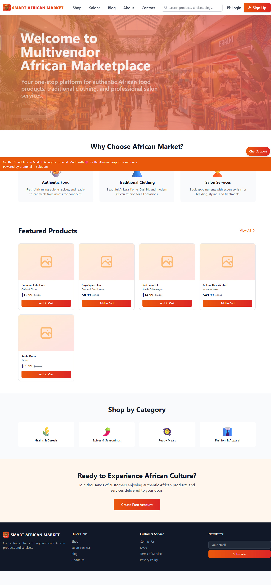
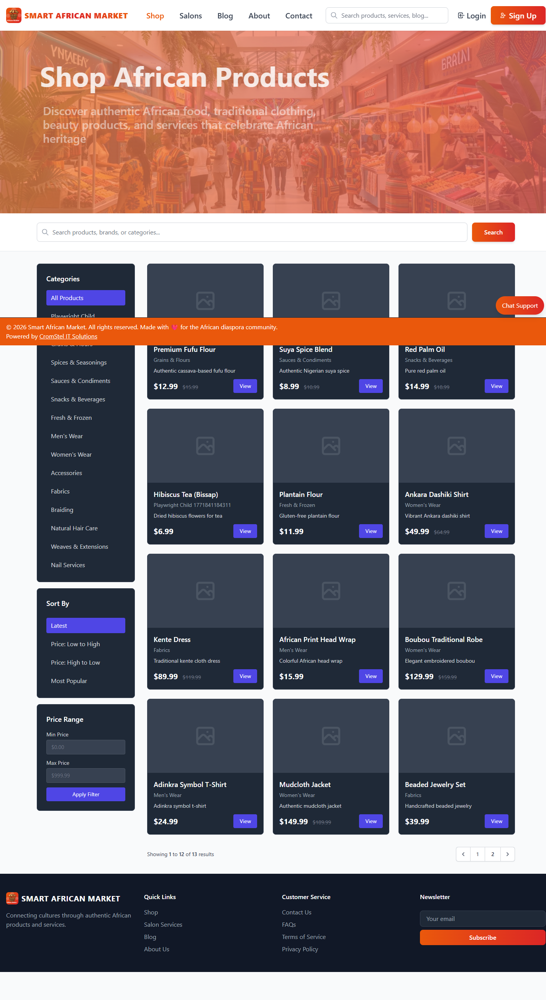
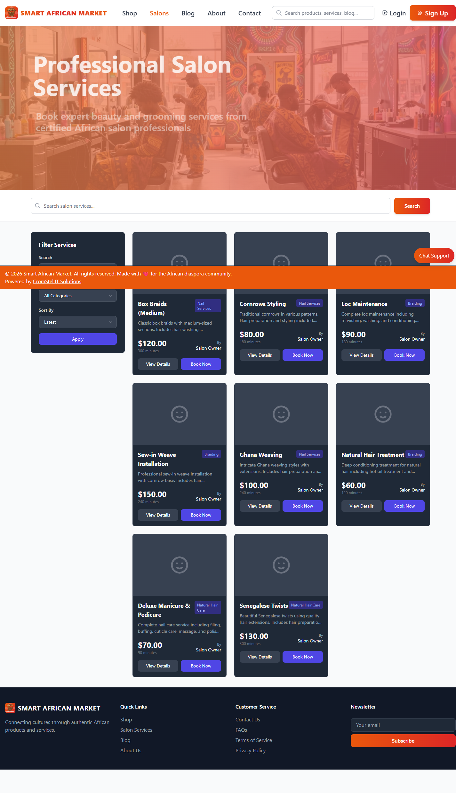
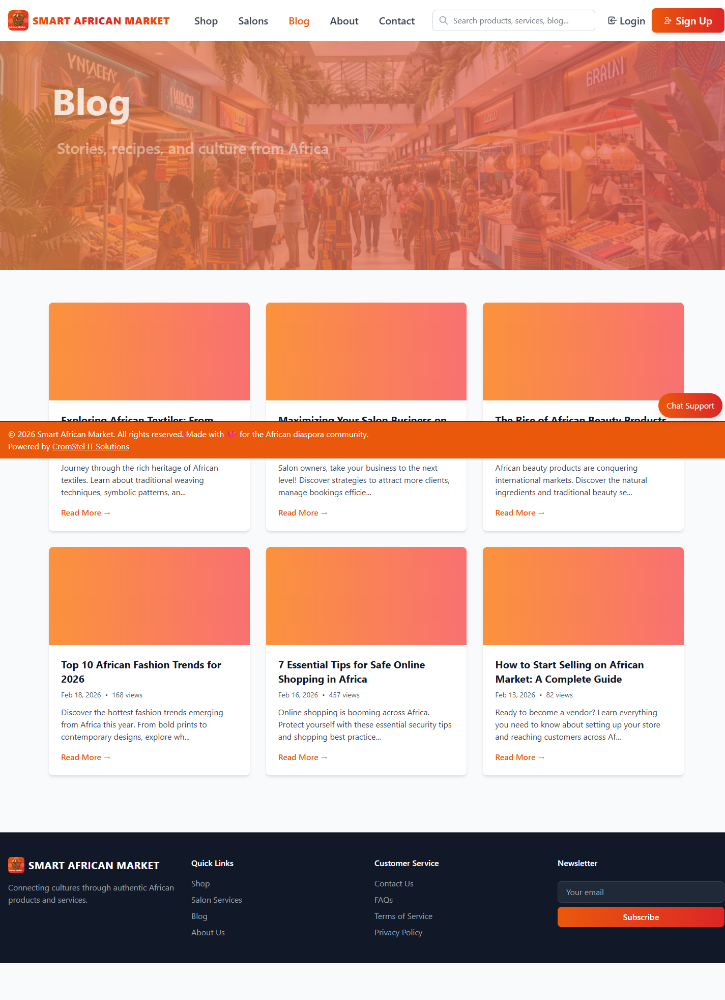
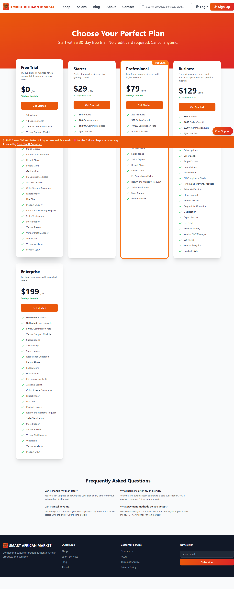
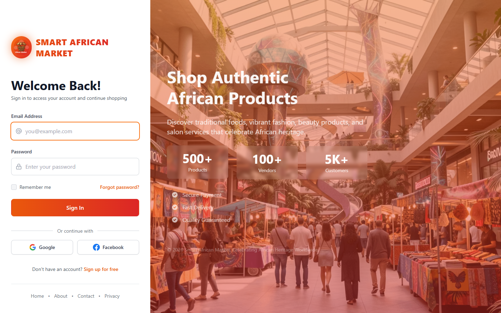
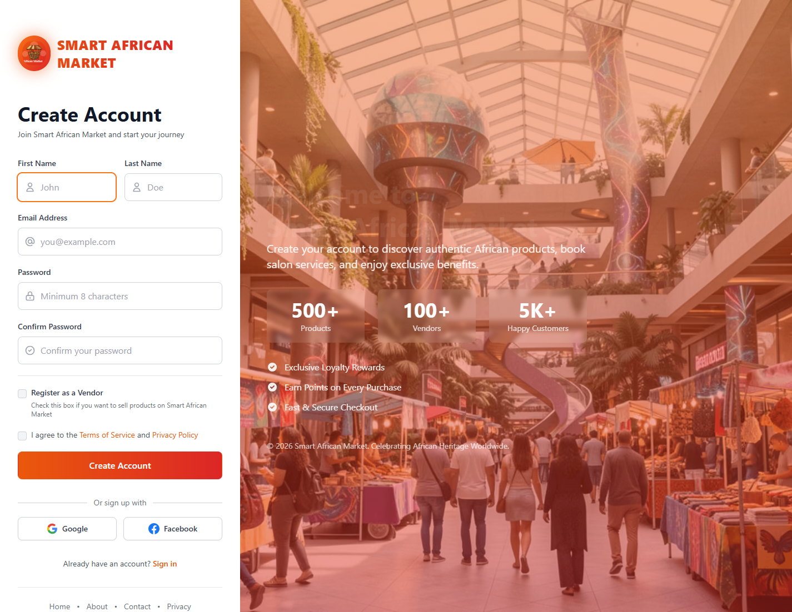

## Customer Login to Dashboard Flow

Goal: Get a customer authenticated and into account workspace.

1. Open `/login`
2. Enter customer credentials
3. Click `Sign In`
4. Confirm redirect to `/dashboard`
5. Use dashboard links to continue with orders, profile, and shopping actions

Screenshots:

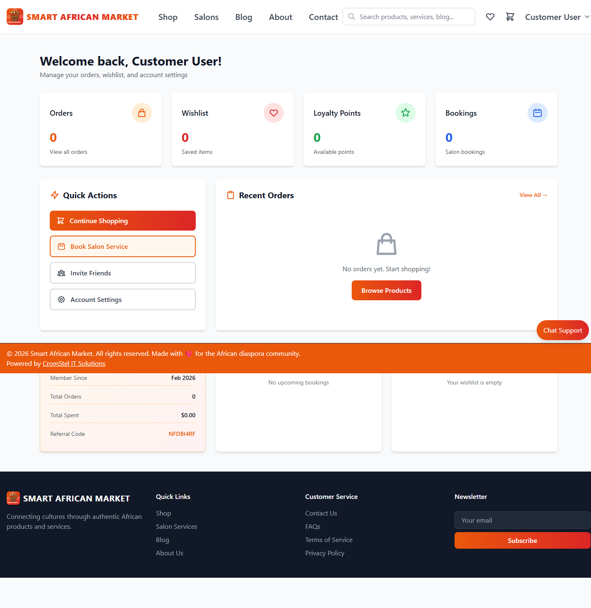

## Vendor Login to Operations Flow

Goal: Move vendor from login to active store operations.

1. Open `/login`
2. Enter vendor credentials
3. Click `Sign In`
4. Confirm redirect to `/vendor/dashboard`
5. Continue to vendor modules (products, orders, withdrawals)

Screenshots:

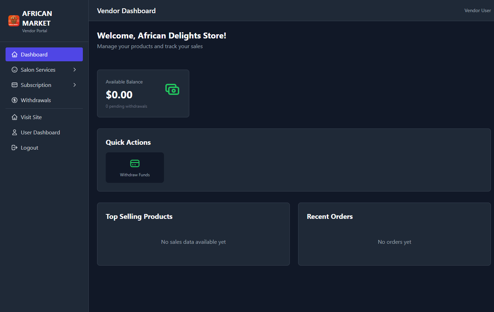

## Enterprise Domain Mapping Flow (Vendor)

Goal: Assign vendor-facing URL and optionally map custom DNS.

1. Vendor opens `/vendor/store-domain`
2. Platform checks subscription entitlement
3. If Enterprise + active subscription:
   - Show domain mapping form
   - Vendor enters custom domain
   - Vendor configures DNS records
   - Vendor runs verification
4. If not Enterprise:
   - Redirect vendor to `/vendor/subscription/upgrade`
   - Vendor upgrades plan first

Screenshots:

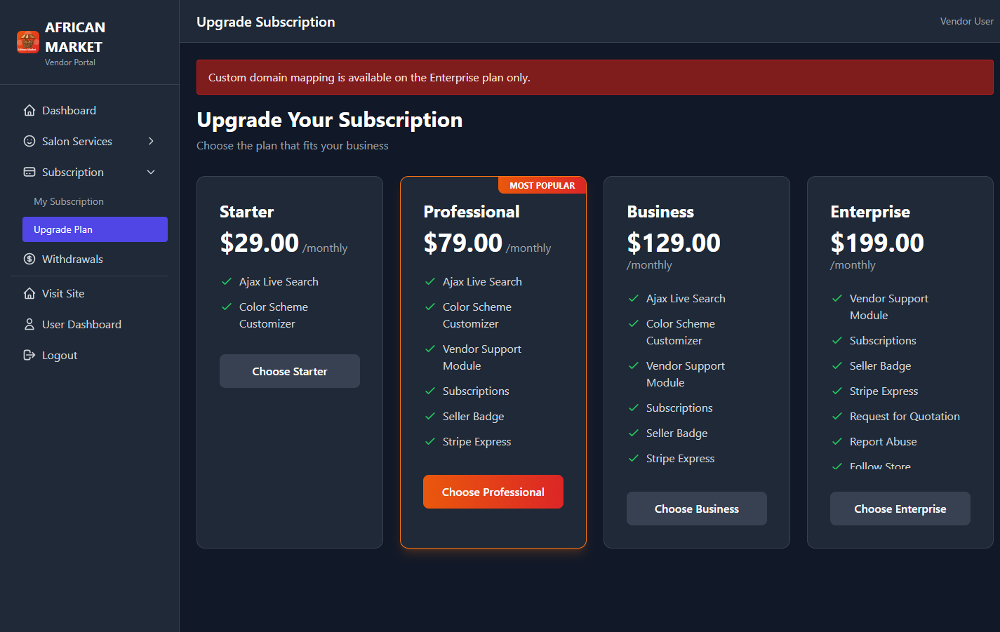
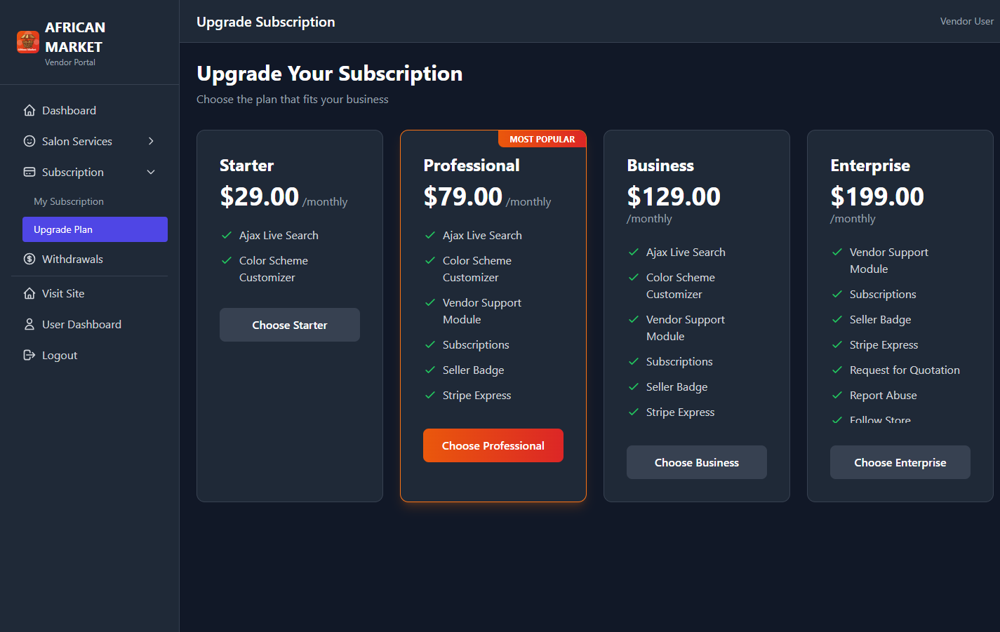

## Admin Control Flow

Goal: Move admin from login to central control panel.

1. Open `/login`
2. Enter admin credentials
3. Click `Sign In`
4. Confirm redirect to `/admin/dashboard`
5. Use `Marketplace Manager` for vendors, services, subscriptions, finance, and shipping settings

Screenshots:

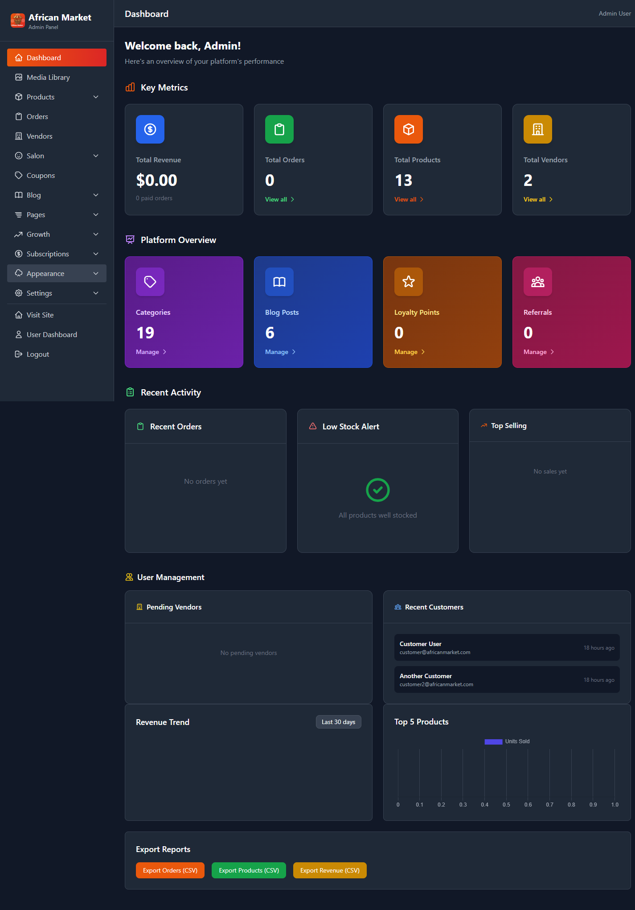

